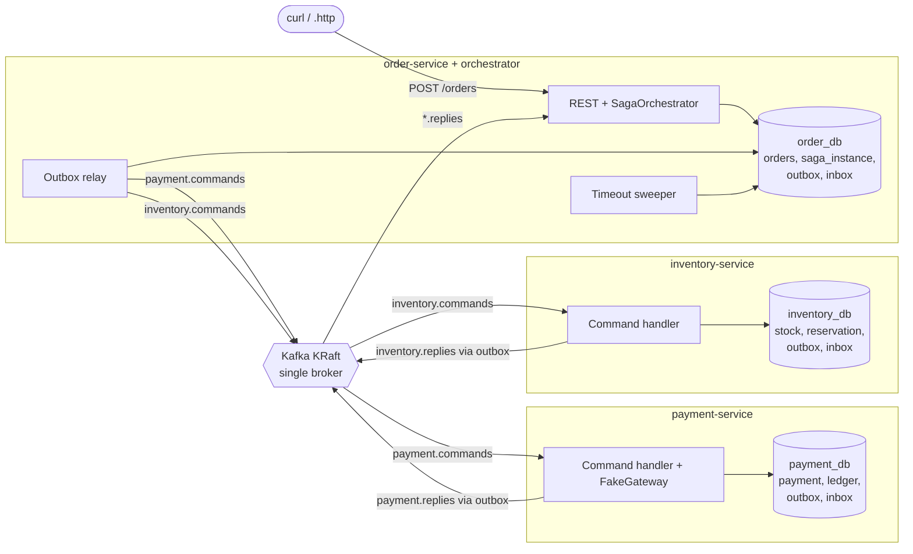
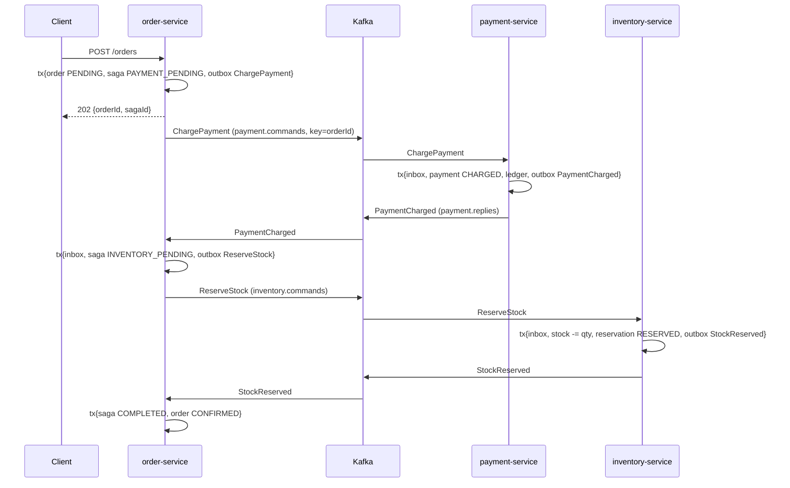
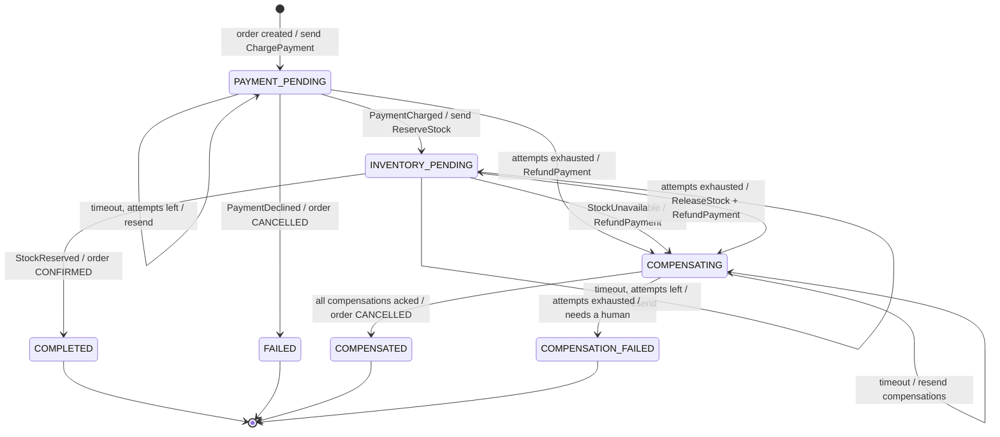

# Sagaverse

A hands-on learning repo for the **saga pattern (orchestration)**. Three Spring Boot services
(order, payment, inventory) talk only through Kafka. The repo first shows how a naive
implementation corrupts data, then fixes it with a persisted saga, compensations, a transactional
outbox, an inbox and a timeout sweeper. Every claim is backed by a test.

> **Status:** Phase 5a (timeouts: stuck sagas are retried, then compensated). Containers and the chaos demo are next. See [PROGRESS.md](PROGRESS.md). Sections marked
> _TBD_ get filled in as phases land.

## The problem

Placing an order spans three services, and each one owns its own database. No distributed
transaction can make "create order + charge card + reserve stock" atomic. So:

- payment is charged, but inventory is out of stock → **money taken for an order that can't ship**;
- a service crashes between saving to its DB and sending its message → **the order hangs forever**;
- a message is delivered twice → **the customer is charged twice, or stock is reserved twice**.

A **saga** splits the transaction into local steps, each committed on its own, and pairs every step
with a **compensating action** (refund, release stock) that undoes it if a later step fails.

## Architecture



### Happy path



### Saga state machine



### Messages

Every message uses the envelope `{eventId, sagaId, type, version, occurredAt, payload}`, keyed by `orderId`.

| Type | Topic | From → To | Kind |
|---|---|---|---|
| ChargePayment | payment.commands | order → payment | command |
| RefundPayment | payment.commands | order → payment | compensation |
| PaymentCharged / PaymentDeclined / PaymentRefunded | payment.replies | payment → order | reply |
| ReserveStock | inventory.commands | order → inventory | command |
| ReleaseStock | inventory.commands | order → inventory | compensation |
| StockReserved / StockUnavailable / StockReleased | inventory.replies | inventory → order | reply |

## Design decisions (ADRs)

| ADR | Decision |
|---|---|
| [0001](docs/adr/0001-service-boundaries-and-orchestration.md) | Service boundaries, state ownership, orchestration |
| [0002](docs/adr/0002-topic-design.md) | Topics, keys, partitions, and why ordering holds per order |
| [0003](docs/adr/0003-saga-state-persistence.md) | Saga state in Postgres; stuck-saga detection |
| [0004](docs/adr/0004-transactional-outbox.md) | Transactional outbox, and why dual writes are unsafe |
| [0005](docs/adr/0005-inbox-and-idempotent-consumers.md) | Inbox plus business idempotency keyed by sagaId |
| [0006](docs/adr/0006-at-least-once-not-exactly-once.md) | At-least-once delivery instead of Kafka EOS |
| [0007](docs/adr/0007-retry-and-dead-letter.md) | Blocking retries and a dead-letter topic |
| [0008](docs/adr/0008-compensation-design.md) | Compensations, tombstones, and failed compensations |
| [0009](docs/adr/0009-timeouts-and-stuck-sagas.md) | Step timeouts and what "stuck" means |
| [0010](docs/adr/0010-naive-vs-reliable-mode.md) | Naive and reliable modes side by side |
| [0011](docs/adr/0011-runtime-tooling-and-testing.md) | Runtime, tooling, test harness, containers |

## Failure modes demonstrated

| # | Scenario | Naive | Reliable |
|---|---|---|---|
| F1 | Payment declined | ✅ CANCELLED/FAILED, no money moved | ✅ same |
| F2 | Out of stock → refund | ✅ CANCELLED/COMPENSATED, ledger CHARGE 10 + REFUND −10 | ✅ same |
| F3 | Duplicate delivery (same eventId, or a resend with a new eventId) | ❌ `DOUBLE_CHARGE` (2 charge rows, net 22.00 on an 11.00 order) + `DOUBLE_RESERVATION` (2 held, 1 ordered) | ✅ 0 violations: inbox skips the redelivery; the sagaId check replies with the stored outcome to the resend |
| F4 | Lost event after crash (dual write) | ❌ `STUCK_SAGA`: PAYMENT_PENDING forever, ChargePayment never sent, 0 durable copies | ✅ COMPLETED; the command survived in the outbox (1 unsent row at crash) and the relay sent it after restart |
| F5 | Inventory down briefly mid-saga | ✅ completes once inventory is back (Kafka kept the command); no resends | ✅ completes; the sweeper resent ReserveStock meanwhile and stock was still reserved once |
| F6 | Inventory down past the step budget | ❌ `STUCK_SAGA`: order PENDING and customer charged for as long as the outage lasts | ✅ gives up after 3 attempts, refunds at once, releases stock when inventory returns → COMPENSATED |
| F7 | Poison message | ✅ sent straight to `<topic>.DLT` with the cause in its headers; later orders unaffected (`PoisonMessageE2EIT`). A poisoned *command* still leaves its saga waiting until the Phase 5 sweeper. | _TBD (Phase 5)_ |
| F8 | Compensation fails transiently | _TBD_ | _TBD_ |
| F9 | Late reply after cancellation | _TBD_ | _TBD_ |

## How to run

Prerequisites: Podman with a running machine (`podman machine start`), and `JAVA_HOME` set explicitly
to a Java 21 JDK. Images come from the internal mirror `docker.intuit.com/docker-rmt` (see ADR-0011).

```bash
export JAVA_HOME=<path-to-intended-jdk>/Contents/Home
make up        # Postgres (3 DBs) + Kafka + topics
make build     # install modules locally
./mvnw -pl order-service spring-boot:run      # likewise payment-service, inventory-service
curl localhost:8081/actuator/health           # 8082 payment, 8083 inventory
```

Then run the requests in [`requests.http`](requests.http) (IntelliJ HTTP client) to place an order and watch
its saga with `GET /orders/{id}`. _The full 5-command demo arrives in Phase 5/6._

## Trade-offs, known limitations, what I'd do in production

_TBD (Phase 6)._

## Non-goals

No auth, UI, cloud/Kubernetes, multi-broker Kafka, Schema Registry, saga frameworks, tracing
stacks, Kafka exactly-once transactions, or load testing. See [AGENTS.md](AGENTS.md).
