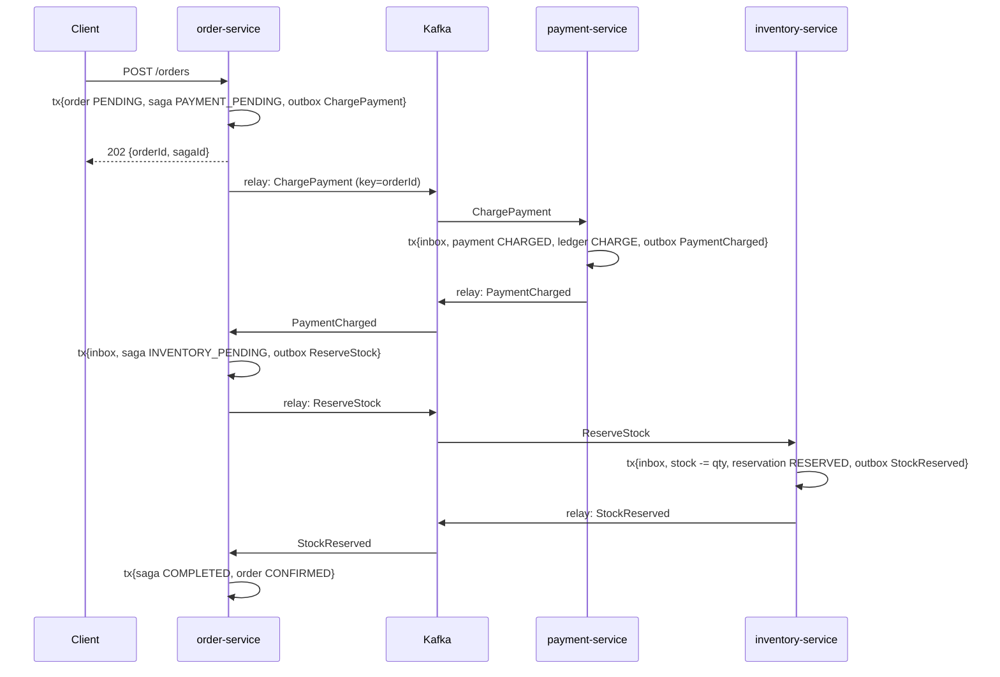
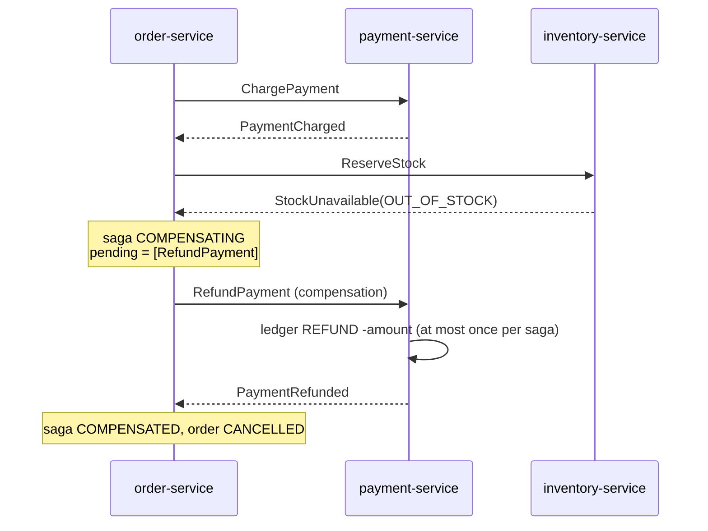
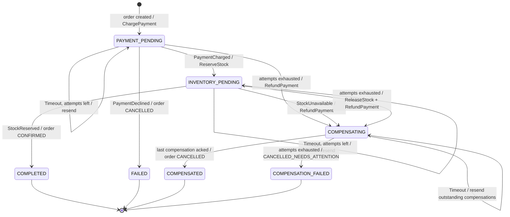

# Sagaverse

A hands-on learning repo for the **saga pattern (orchestration)**. Three Spring Boot services (order,
payment, inventory) talk only through Kafka. The repo first shows, with tests and numbers, how a
naive implementation corrupts data. Then it fixes each problem: a persisted saga state machine,
compensations, a transactional outbox, an inbox, and a timeout sweeper. Both versions live side by
side, so the difference stays visible.

> **Status:** complete. All failure modes F1 to F9 have end-to-end tests in both modes, and there's a
> containerized stack with a demo and a chaos demo. See [PROGRESS.md](PROGRESS.md) for the build log.

**What you'll learn here**

- Why "save to my DB, then send a message" (a *dual write*) loses messages, and how an **outbox** fixes it.
- Why at-least-once delivery means **every consumer must be idempotent**, and the two layers that make it so.
- How an **orchestrator** drives a multi-service transaction as an explicit **state machine**.
- What a **compensating action** is, why it must be idempotent, and what to do when it fails too.
- How **timeouts** turn "waiting forever" into "retry, then give up and undo".

---

## 1. The problem

Placing an order spans three services. Each one owns its own database, so no single ACID transaction
can make "create order + charge card + reserve stock" atomic. Without care, these things happen. Each
was reproduced in this repo against the **naive** implementation:

| What goes wrong | What the customer sees | Reproduced as |
|---|---|---|
| Out of stock after the card was charged | Charged for an order that will never ship | F2 before Phase 3 |
| The service crashes between saving to its DB and sending its message | Order stuck in PENDING forever | F4 |
| A message is delivered twice (normal for Kafka) | Charged twice, stock held twice | F3 |
| A downstream service is down for a long time | Order PENDING and money taken, for as long as the outage lasts | F6 |
| A refund keeps failing | Money never comes back, and nobody notices | F8 |

## 2. The saga pattern in one minute

A **saga** replaces one big transaction with a sequence of **local** transactions, one per service,
connected by messages. Every step that changes something has a **compensating action** that
semantically undoes it: a refund undoes a charge, and a stock release undoes a reservation. If a later
step fails, the saga runs the compensations for the steps that already happened.

There are two ways to coordinate a saga:

- **Choreography:** each service reacts to the others' events. Nobody is in charge.
- **Orchestration** (used here): one component, the orchestrator, tells each service what to do and
  decides what happens next. The whole flow lives in one place, which makes it easy to read, test and
  debug. See [ADR-0001](docs/adr/0001-service-boundaries-and-orchestration.md).

What a saga does **not** give you is isolation. Between steps, other readers can see an order that is
PENDING, or a charge that will be refunded a second later. The saga guarantees the system *ends up*
consistent, not that it never looks inconsistent along the way.

## 3. Architecture


- **No direct calls between services.** Kafka is the only channel. There are separate command and
  reply topics, all keyed by `orderId`, so everything about one order is processed in order
  ([ADR-0002](docs/adr/0002-topic-design.md)).
- **No shared database.** One Postgres instance holds three databases, and each service user can
  connect only to its own. The `events` module holds message *contracts* only.

### Happy path



### Out of stock: compensation



### Saga state machine



A `StockReserved` that arrives *after* cancellation, for example a resend that was still in flight,
triggers a `ReleaseStock` without changing the state ([ADR-0008](docs/adr/0008-compensation-design.md)).
The state machine is a pure function (`SagaStateMachine`) with 25 unit tests.

### Messages

Every message uses the envelope `{eventId, sagaId, type, version, occurredAt, payload}` as JSON, keyed by `orderId`.

| Type | Topic | From → To | Kind |
|---|---|---|---|
| ChargePayment | payment.commands | order → payment | command |
| RefundPayment | payment.commands | order → payment | compensation |
| PaymentCharged / PaymentDeclined / PaymentRefunded | payment.replies | payment → order | reply |
| ReserveStock | inventory.commands | order → inventory | command |
| ReleaseStock | inventory.commands | order → inventory | compensation |
| StockReserved / StockUnavailable / StockReleased | inventory.replies | inventory → order | reply |
| (anything unprocessable) | `<topic>.DLT` | error handler | dead letter |

---

## 4. How to run

**Prerequisites:**
- Podman with a running machine (`podman machine start`). On this network, images come from the
  internal mirror `docker.intuit.com/docker-rmt`, because `docker.io` is blocked
  ([ADR-0011](docs/adr/0011-runtime-tooling-and-testing.md)).
- A Java 21 JDK, chosen explicitly. Nothing here picks a JDK by version number.
- bash, curl, make.

```bash
export JAVA_HOME=<path-to-intended-jdk>/Contents/Home
```

**Five commands:**

```bash
make up-all                 # build 3 images (Jib), start Postgres, Kafka, topics and the services; waits until healthy
make demo                   # happy path, payment declined, out of stock; prints each saga's outcome and sagaId
make chaos-inventory        # SIGKILL inventory mid-saga, watch resends, restart it, saga completes
make trace SAGA=<sagaId>    # every log line of that saga from all three services, in time order
make down
```

`make demo` prints, for example:

```
SCENARIO                     EXPECTED                   ACTUAL                     SAGA_ID
happy path                   CONFIRMED/COMPLETED        CONFIRMED/COMPLETED        c3f3cc03-…
F1 payment declined          CANCELLED/FAILED           CANCELLED/FAILED           11039227-…
F2 out of stock -> refund    CANCELLED/COMPENSATED      CANCELLED/COMPENSATED      49fd65c6-…
all scenarios ended as expected
```

and `make trace SAGA=49fd65c6-…` (the out-of-stock saga) prints:

```
18:20:36.863  order-service      SagaOrchestrator       order placed, saga started in PAYMENT_PENDING
18:20:37.001  order-service      OutboxRelay            relayed ChargePayment to payment.commands (eventId=f8b1…)
18:20:37.002  payment-service    CommandListener        received ChargePayment (eventId=f8b1…)
18:20:37.004  payment-service    PaymentService         charged 10.00 to demo-1795198836
18:20:37.111  order-service      SagaOrchestrator       saga PAYMENT_PENDING -> INVENTORY_PENDING on PaymentCharged (attempt 1)
18:20:37.209  inventory-service  InventoryService       cannot reserve 1 x SKU-EMPTY: out of stock
18:20:37.420  order-service      SagaOrchestrator       saga INVENTORY_PENDING -> COMPENSATING on StockUnavailable (attempt 1) awaiting [RefundPayment]
18:20:37.634  payment-service    PaymentService         refunded 10.00 to demo-1795198836 (OUT_OF_STOCK)
18:20:37.723  order-service      SagaOrchestrator       saga COMPENSATING -> COMPENSATED on PaymentRefunded (attempt 0)
```
(Excerpt. The real output also shows every relay and receive.)

**Tests:** `make verify` runs formatting, Error Prone, unit tests, integration tests and the e2e suite (96 tests,
about 6 minutes). `make test` runs unit tests only.

**Dev mode** (services on your machine, for debugging):
`make up && make build`, then `./mvnw -pl order-service spring-boot:run` (and likewise payment-service and
inventory-service). Ports are 8081, 8082 and 8083. Use [`requests.http`](requests.http) to place orders and trigger
each failure path.

**Useful knobs** (env vars or `--name=value`):

| Property | Service | Default | Effect |
|---|---|---|---|
| `saga.mode` | all | `reliable` | `naive` = dual write, no dedup, no sweeper (the buggy version, for comparison) |
| `saga.step-timeout` / `saga.max-step-attempts` | order | 10s / 6 | when a step counts as stuck, how often to resend |
| `saga.max-compensation-attempts` / `saga.sweep-interval` | order | 10 / 2s | compensation retries; sweeper frequency |
| `payment.decline-amount-over` / `payment.fail-rate` | payment | 1000.00 / 0.0 | trigger declines (F1) |
| `payment.refund-fail-times` | payment | 0 | the first N refunds fail transiently (F8) |
| `fault.crash-before-publish` | order | false | simulate a crash between commit and send (F4) |
| `messaging.retry.*` | all | 1s ×2, 3 retries | blocking retry before dead-lettering |

---

## 5. Naive vs reliable: measured results

Each row is an end-to-end test that boots all three real services against real Kafka and Postgres.
`NaiveModeE2EIT` asserts that the bug happens; `ReliableModeE2EIT` asserts zero invariant violations.
The **InvariantChecker** reads all three databases and flags `DOUBLE_CHARGE`, `WRONG_CHARGE`,
`UNREFUNDED_CHARGE`, `DOUBLE_RESERVATION`, `ORPHAN_RESERVATION` and `STUCK_SAGA`.

| # | Scenario | Naive | Reliable |
|---|---|---|---|
| F1 | Payment declined | ✅ CANCELLED/FAILED, no money moved | ✅ same |
| F2 | Out of stock → refund | ✅ CANCELLED/COMPENSATED, ledger CHARGE 10 + REFUND −10 | ✅ same |
| F3 | Duplicate delivery (same eventId, or a resend with a new eventId) | ❌ `DOUBLE_CHARGE` (2 charge rows, net 22.00 on an 11.00 order) + `DOUBLE_RESERVATION` (2 held, 1 ordered) | ✅ 0 violations: inbox skips the redelivery; the sagaId check answers the resend with the stored outcome |
| F4 | Crash between DB commit and send | ❌ `STUCK_SAGA`: PAYMENT_PENDING forever, ChargePayment never sent, 0 durable copies | ✅ COMPLETED: the command survived in the outbox (1 unsent row at crash) and was relayed after restart |
| F5 | Inventory down briefly mid-saga | ✅ completes once inventory is back (Kafka kept the command); no resends | ✅ completes; the sweeper resent ReserveStock meanwhile, and stock was still reserved once |
| F6 | Inventory down past the step budget | ❌ `STUCK_SAGA`: order PENDING and customer charged for as long as the outage lasts | ✅ gives up after 3 attempts, refunds at once, releases stock when inventory returns → COMPENSATED |
| F7 | Poison message | ✅ (both modes) sent straight to `<topic>.DLT` with the cause in headers; later orders on the same partitions unaffected | ✅ same. A dead-lettered *command* of a live saga is then a missing reply, handled like F6/F8 |
| F8 | Refund fails (first 5 attempts / forever) | ❌ refund lands in the DLT, saga stuck COMPENSATING, money taken (`STUCK_SAGA`) | ✅ sweeper resends → COMPENSATED. If it never succeeds: COMPENSATION_FAILED, order CANCELLED_NEEDS_ATTENTION, `UNREFUNDED_CHARGE` flagged for a human |
| F9 | Late reservation after cancellation | ✅ released (the rule lives in the shared state machine) | ✅ released: `COMPENSATED -> COMPENSATED on StockReserved(late)`, then ReleaseStock |

The chaos demo (`make chaos-inventory`) is F5 with real containers and `podman kill`. In the
recorded run, ReserveStock was delivered 5 times (the original plus 4 resends). Inventory reserved
once and answered the other 4 from the stored outcome, and payment charged once.

---

## 6. Design decisions, explained

Each decision has an ADR with the trade-offs and the rejected alternatives. Here's the gist, for a first read:

- **Orchestration in order-service** ([0001](docs/adr/0001-service-boundaries-and-orchestration.md)). The saga's
  logic is in one class you can read top to bottom, and saga state and order status change in one local
  transaction. The cost is that order-service does two jobs.
- **One topic per direction, keyed by orderId** ([0002](docs/adr/0002-topic-design.md)). Kafka only orders messages
  within a partition, and the key picks the partition. Keying by orderId means a Refund can never overtake its Charge.
- **Saga state in Postgres** ([0003](docs/adr/0003-saga-state-persistence.md)). In memory, a restart would forget
  every saga. A row per saga, with an optimistic `version`, survives crashes, and the sweeper can find stuck sagas
  with one indexed query.
- **Transactional outbox** ([0004](docs/adr/0004-transactional-outbox.md)). You can't atomically write to Postgres
  *and* Kafka. So write the message *into Postgres*, in the same transaction, and let a relay copy it to Kafka. The
  relay may send twice, but it never loses anything.
- **Inbox + business keys** ([0005](docs/adr/0005-inbox-and-idempotent-consumers.md)). Because the relay may send
  twice, consumers record each `eventId` they process (the inbox) and skip repeats. Resends carry *new* eventIds,
  so handlers also check "did I already do this for this sagaId?" and repeat the earlier answer.
- **At-least-once, not Kafka exactly-once** ([0006](docs/adr/0006-at-least-once-not-exactly-once.md)). Kafka's
  transactions can't include a Postgres write, so they wouldn't fix the dual write anyway.
- **Blocking retries, then a dead-letter topic** ([0007](docs/adr/0007-retry-and-dead-letter.md)). Retrying in place
  keeps per-order ordering. Messages that can never work, such as malformed or unknown versions, skip the retries,
  so they don't block the partition.
- **Idempotent compensations with tombstones** ([0008](docs/adr/0008-compensation-design.md)). On a timeout we can't
  know whether a step ran, so we undo everything that *might* have happened. Undoing something that didn't happen
  is a harmless no-op, and it leaves a tombstone so a late original is refused.
- **Timeouts** ([0009](docs/adr/0009-timeouts-and-stuck-sagas.md)). "Stuck" means non-terminal with the step
  deadline passed. Resend a few times, then compensate. If compensations keep failing, stop and flag it for a
  human rather than retrying forever.
- **Naive and reliable side by side** ([0010](docs/adr/0010-naive-vs-reliable-mode.md)). One codebase, with the
  strategy beans switched by `saga.mode`. The diff between the two publisher and guard implementations *is* the lesson.
- **Runtime and tests** ([0011](docs/adr/0011-runtime-tooling-and-testing.md)). The e2e tests boot all three real
  services in one JVM against Testcontainers, and a "crash" means closing a service's Spring context.

## 7. Trade-offs

- **Latency vs safety.** The outbox adds up to one relay interval (200 ms) per hop, about 1 s for a full saga.
  The naive version is faster, and it's wrong.
- **Duplicates are normal.** At-least-once delivery means every handler pays for an inbox insert, and must be
  written to answer "already done" correctly.
- **Over-compensation.** After a timeout we refund and release even if the step never ran. That's safe because
  compensations are idempotent, but it costs messages and makes logs noisier.
- **Copy, don't share.** Each service has its own outbox, inbox, codec and error handler, so a change means
  editing three places. In exchange, services can evolve and deploy independently.
- **Payment before inventory**, because the brief says so. The usual production order is to reserve stock first
  (cheap to undo) and charge last (expensive to undo).

## 8. Known limitations

- **The outbox relay is single-instance per service.** Several relays would need per-key ordering, such as
  partitioning the outbox by key, or CDC.
- **Housekeeping.** Outbox and inbox rows are never deleted. Tombstones are kept forever.
- **The sweeper is also single-instance.** `FOR UPDATE SKIP LOCKED` makes several instances safe, but they're untested here.
- **Thin DLT tooling.** Dead letters are kept and `make dlt-replay` re-sends them, but there's no alerting, and
  replayed records lose the `kafka_dlt-*` headers.
- **Poison costs throughput.** Each dead-lettered record stalls its partition for about 0.4 s (the error handler
  seeks back and re-polls). Measured: about 2.5 poison records per second on one partition.
- **Logging context gaps.** In the in-JVM e2e tests, every log line's `service.name` shows the first-started
  service; containers label correctly. Framework start-up lines carry no sagaId.
- **Large images.** They're about 594 MB each because the base is a full JDK.
- **No isolation between sagas.** For example, two orders racing for the last unit are serialized by the stock
  `UPDATE … WHERE available >= qty`, but a reader can still see intermediate states.
- **The payment gateway and money are fake.** There are no currencies, partial refunds or chargebacks.

## 9. What I'd do in production

- Replace the polling relay with **CDC** (Debezium on the outbox table). That gives lower latency and no polling load.
- Use **Schema Registry** (Avro or Protobuf) with compatibility rules, instead of a hand-versioned JSON envelope.
- **Distributed tracing** (OpenTelemetry), with the sagaId as a baggage item, plus metrics and alerts: stuck sagas,
  COMPENSATION_FAILED, DLT depth, relay lag.
- **TTL jobs** for the inbox, the outbox and tombstones, sized well beyond the longest redelivery or replay window.
- A **runbook and admin API** for COMPENSATION_FAILED sagas (retry, mark resolved) and for DLT replay.
- **Reserve-then-charge** ordering, and real gateway idempotency keys (the sagaId) on the payment provider's API.
- Run several instances of each service and test the relay and sweeper under contention. Run chaos tests continuously.
- Consider a workflow engine (Temporal, Camunda) once there are many sagas. This repo hand-builds one on purpose, to
  show the mechanics.

## 10. Operating it

**Replay dead letters**, after fixing whatever made them fail:

```bash
make dlt-replay TOPIC=payment.commands
```

It re-sends each dead letter of `payment.commands.DLT` to `payment.commands` **once**. A consumer group
(`dlt-replay-<topic>`) remembers what was already replayed, and each run takes exactly the backlog it
found at start. Replays are safe: the inbox and sagaId checks make duplicates no-ops, and tombstones
refuse commands for sagas that were already cancelled.

> ⚠️ Don't use the obvious one-liner, `kafka-console-consumer --topic X.DLT | kafka-console-producer --topic X`.
> If the record still fails, it is dead-lettered again, read again and replayed again, forever. Tried
> here: one poison record went round **95 times in 2 minutes** before I stopped it.

**Look around:** `make topics`, `make consume TOPIC=payment.replies`, `make ps`, `make logs`, and `GET /orders/{id}`,
which shows the saga state, attempts, deadline and full transition history.

## 11. Project layout

| Path | What |
|---|---|
| `events/` | Message contracts: envelope, payload records, `EventType` catalogue, topic names |
| `order-service/` | REST API, `saga/` (state machine, orchestrator, sweeper), `messaging/` (outbox, inbox, codec, DLT) |
| `payment-service/`, `inventory-service/` | Command handlers, fake gateway / stock, their own outbox, inbox and codec |
| `e2e-tests/` | `SagaverseCluster`, `ScenarioRunner`, `InvariantChecker`, naive vs reliable suites |
| `compose.yaml`, `infra/`, `scripts/`, `Makefile` | Local runtime, demo, chaos, trace and DLT replay |
| `docs/adr/` | 11 architecture decision records |
| `requests.http` | Hand-driven requests for every path |

## Non-goals

No auth, UI, cloud/Kubernetes, multi-broker Kafka, Schema Registry, saga frameworks, tracing stacks,
Kafka exactly-once transactions, or load testing. See [AGENTS.md](AGENTS.md).
